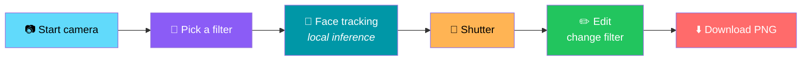
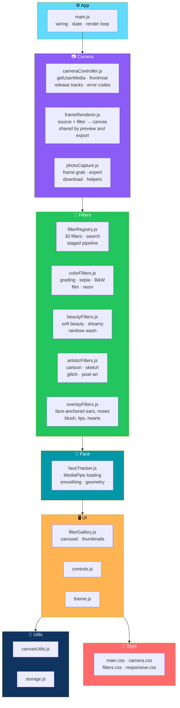

# ✨ FilterMagic

<div align="center">


**A super-cute live camera filter website.**

*30 filters · Face-anchored effects · Selfies · PNG download — all in your browser*

[🚀 Run It Locally](#-run-it-locally) • [📱 Test on Phone](#-testing-on-a-phone-or-tablet-over-your-network) • [🎨 Using the App](#-using-the-app) • [🏗️ Architecture](#️-architecture) • [🔒 Privacy](#-privacy)

</div>

---

## 📖 Overview

**FilterMagic** is a **super-cute live camera filter website**.

Open your camera, try **30 filters**, take selfies, and download them as PNGs.

### Core Idea

> **Everything runs in your browser.**
>
> **Photos and video are never uploaded.**

### What It's Built With

- **HTML5 · CSS3 · vanilla JavaScript (ES modules)**
- **WebRTC `getUserMedia`**
- **Canvas API**
- **LocalStorage**
- **MediaPipe Face Landmarker** — for face-anchored effects

### The Flow



---

## 🚀 Run It Locally

> ⚠️ **ES modules and the camera need a web server.**
>
> Opening `index.html` from the file system **will not work**.
>
> Camera access works on `http://localhost` and on any `https://` page.

### With Node *(18+)*

```bash
npm start          # serves http://localhost:8080 (npx http-server)
```

### With Python

```bash
python3 -m http.server 8080
```

### Then

Open **http://localhost:8080** and press **Start camera**.

---

## 📱 Testing on a Phone or Tablet Over Your Network

> ⚠️ **Phones will NOT give camera access to `http://192.168.x.x`.**
>
> **Use HTTPS.**

### Option 1 — Local Certificate with mkcert

**mkcert is the easiest way:** [github.com/FiloSottile/mkcert](https://github.com/FiloSottile/mkcert)

```bash
# 1. make a local certificate
mkcert -install && mkcert -key-file key.pem -cert-file cert.pem localhost 192.168.1.50

# 2. serve over HTTPS
npm run start:https     # https://<your-ip>:8443
```

### Option 2 — Tunnel Your Local Server

Use a service that gives you an **HTTPS URL**:

- **Cloudflare Tunnel**
- **ngrok**

---

## 🚢 Deploy *(HTTPS Hosting)*

> **FilterMagic is a static site with no build step.**

**Upload the whole folder to any static host that serves HTTPS:**

- **GitHub Pages**
- **Netlify**
- **Vercel**
- **Cloudflare Pages**
- **Firebase Hosting**

**Publish the repository root** — `index.html`, `src/`, `public/`.

> ✅ **Camera permission only works on the HTTPS URL these hosts give you.**

---

## 🎨 Using the App

### 🎥 Live

- **Press *Start camera***
- **Pick a filter** from the carousel
- **Press the big shutter**
- **Timer button** cycles: **Off → 3s → 5s → 10s**

### 🎚️ Intensity

- The slider **scales every filter from 0% to 100%**
- **Reset** returns to **Original at 100%**

### 💗 Save & Compare

- **Save (heart)** adds the current filter to **Favorites**
- **Compare** shows **before and after with a slider**

### 🪞 Mirror

- **Mirror** flips the selfie preview *(and the saved photo to match)*
- **The rear camera turns mirroring off automatically**

### 🔄 Flip Cam

**Appears when the device has more than one camera.**

### ✏️ Edit

- **Upload an image** — or **drag one onto the preview**
- Apply filters
- **Download PNG**

> 💡 **After taking a photo you land in Edit**, where you can still change the filter before downloading.
>
> **Retake** returns to the camera.

### 📸 My Photos

**Keeps this session's captures** *(up to **24**)*.

> 🔒 **They are held in memory only, not in LocalStorage.**

### 💾 What Persists

**Favorites, theme, last filter, intensity, timer, mirror, and camera choice** persist in **LocalStorage**.

---

## 🧠 Face Tracking and Fallback

### 🎭 Face-Anchored Filters

These **12 filters** anchor their decorations to **real face landmarks** and **follow your movement**:

<div align="center">

| Filter | Filter | Filter | Filter |
|:---:|:---:|:---:|:---:|
| 🐱 **Cat** | 🐶 **Puppy** | 🐰 **Bunny** | 🐻 **Bear** |
| 😇 **Angel** | 🌸 **Rosy Blush** | 🍒 **Cherry Lips** | 😍 **Heart Eyes** |
| ⭐ **Starry Face** | 🌈 **Rainbow Magic** | ✨ **Kawaii Sparkles** | 💖 **Super Cute** |

</div>

**Landmarks used:** forehead · eyes · nose · cheeks · lips · head tilt

### 📦 How the Tracker Loads

- **Loads on demand** — only after the camera is on or a photo is open
- **From jsDelivr** — WebAssembly runtime
- **From Google Storage** — model file *(about **4 MB**)*

> 🔒 **Video frames are processed locally. Only those library files are downloaded.**

### 🛡️ What Happens If It Fails

**If the tracker cannot load** *(offline, blocked, unsupported browser)*:

- **The app says so**
- **Applies the colour part of each effect**
- **Never draws static decorations pretending to be tracked**

**If no face is visible:**

- **Decorations hide**
- **A hint appears**

### 🏠 Self-Hosting the Library

1. Download **`@mediapipe/tasks-vision`** — `vision_bundle.mjs` and its `wasm/` folder
2. Download **`face_landmarker.task`**
3. Change the URLs in **`FACE_CONFIG`** at the top of `src/face/faceTracker.js`

---

## 🏗️ Architecture

### System Overview



### 🎨 The Filter Pipeline


> 💡 **A filter is a plain object.**
>
> **Its optional stages run in order:** `pre` *(canvas)* → `pixel` *(ImageData)* → `post` *(canvas)* → `overlay` *(face-anchored)*.

### ➕ Adding a Filter

**Three steps:**

1. Write the **stage functions**
2. Add **one entry to `FILTERS`** in `filterRegistry.js`
3. **The carousel, search, favorites, and export pick it up automatically**

> ✅ **Filter thumbnails are generated at start-up — no image assets are needed.**

### 📂 Project Layout

```
filtermagic/
├── index.html
├── package.json
├── public/
│   └── favicon.svg
│
├── src/
│   ├── main.js                  app wiring · state · render loop
│   │
│   ├── styles/                  main.css · camera.css
│   │                            filters.css · responsive.css
│   │
│   ├── camera/
│   │   ├── cameraController.js  getUserMedia · front/rear switch
│   │   │                        releasing tracks · error codes
│   │   ├── frameRenderer.js     draws source + filter onto a canvas
│   │   │                        (preview and export share it)
│   │   └── photoCapture.js      frame grab · export · download · helpers
│   │
│   ├── filters/
│   │   ├── filterRegistry.js    the 30 filters · search
│   │   │                        staged pipeline
│   │   ├── colorFilters.js      grading · sepia · B&W · film · neon
│   │   ├── beautyFilters.js     soft beauty · dreamy · rainbow wash
│   │   ├── artisticFilters.js   cartoon · sketch · glitch · pixel art
│   │   └── overlayFilters.js    face-anchored ears, noses, blush
│   │                            lips, hearts, sparkles
│   │
│   ├── face/
│   │   └── faceTracker.js       MediaPipe loading · smoothing
│   │                            face geometry
│   │
│   ├── ui/
│   │   ├── filterGallery.js     carousel + thumbnails
│   │   ├── controls.js
│   │   └── theme.js
│   │
│   └── utils/
│       ├── canvasUtils.js
│       └── storage.js
│
└── tests/
    └── filters.test.js
```

### Design Principles

<div align="center">

| Principle | Implementation |
|-----------|---------------|
| **🔒 Privacy by architecture** | No analytics, no uploads, no server — the camera only starts on user action |
| **🎨 Filters are plain objects** | The pipeline is data-driven — adding a filter needs no changes to the carousel, search, or export |
| **🖼️ One renderer, two uses** | `frameRenderer.js` is shared by both the live preview and the export |
| **🧠 Face tracking is local** | Video frames never leave the browser — only the library and model are downloaded |
| **🚫 No fake tracking** | If tracking fails, the app says so and applies only the colour part — **it never pretends** |
| **🖼️ No image assets** | Filter thumbnails are generated at start-up |
| **💾 Session photos are ephemeral** | Up to 24, in memory only — preferences persist, photos don't |
| **📱 Mobile is first-class** | HTTPS is documented, mirroring auto-disables on rear camera, iOS Safari save guidance provided |
| **🔌 Libraries can be self-hosted** | Change `FACE_CONFIG` to swap CDN URLs |

</div>

---

## 🧪 Tests

```bash
npm test
```

### What's Covered

<div align="center">

| Area | Coverage |
|------|:--------:|
| **30-filter registry** | ✅ |
| **Intensity behavior of every pixel filter** — 0% = unchanged, stronger at higher values | ✅ |
| **Search and categories** | ✅ |
| **Face geometry and mirroring** | ✅ |
| **Every face overlay draws only when landmarks exist** | ✅ |

</div>

---

## 🔒 Privacy

<div align="center">

| Guarantee | Implementation |
|-----------|---------------|
| **No analytics** | None |
| **No uploads** | None |
| **No server** | None |
| **Camera starts only on request** | Only after you press **Start camera** |
| **Camera stops on exit** | Stops when you turn it off or leave the page |
| **All tracks are released** | Every track is released when the camera stops |

</div>

---

## 🌐 Browser Support

**Current Chrome, Edge, Firefox, and Safari** on:

- Windows
- macOS
- Linux
- Android
- iOS and iPadOS

### Requirements

Needs:

- **`getUserMedia`**
- **Canvas**
- **ES modules**

> ✅ **Unsupported features show a clear message instead of failing silently.**

### 📱 iOS Safari Note

> **If the PNG opens in a new tab instead of downloading**, **press and hold it and choose Save to Photos**.

---

## 🗺️ Roadmap

### ✅ Current

- [x] Live camera preview via WebRTC `getUserMedia`
- [x] 30 filters with a staged pipeline — `pre` → `pixel` → `post` → `overlay`
- [x] 12 face-anchored filters using MediaPipe Face Landmarker
- [x] Graceful fallback when face tracking is unavailable — colour-only
- [x] Intensity slider from 0% to 100% with reset
- [x] Before/after comparison slider
- [x] Favorites with heart save
- [x] Mirror toggle that auto-disables on rear camera
- [x] Front/rear camera switch when available
- [x] Timer with 3s / 5s / 10s options
- [x] Photo capture up to 24 session photos in memory
- [x] Edit mode with filter change after capture
- [x] Image upload and drag-drop to preview
- [x] PNG download
- [x] Persisted favorites, theme, last filter, intensity, timer, mirror, and camera choice
- [x] Filter search and categories
- [x] Generated filter thumbnails — no image assets
- [x] Local-only video processing — only the library and model are downloaded
- [x] Self-hostable MediaPipe configuration via `FACE_CONFIG`
- [x] No analytics, no uploads, no server
- [x] Camera tracks released on exit
- [x] Clear messages for unsupported features
- [x] Test suite covering registry, intensity, search, geometry, and overlay guards
- [x] HTTPS guidance for local phone testing with mkcert or tunnels
- [x] iOS Safari save guidance

### 🔜 Future Ideas

- [ ] **More filters** beyond the current 30
- [ ] **Filter stacking** — combine multiple filters
- [ ] **Animated filters** — time-based effects
- [ ] **Multi-face tracking** — group selfies
- [ ] **Video recording** — export short clips
- [ ] **Custom filter editor** — build filters from a UI
- [ ] **Preset bundles** — curated filter packs
- [ ] **Opt-in cloud sync** — for favorites and presets
- [ ] **Accessibility controls** — reduced motion for animated overlays
- [ ] **Localization** — bilingual UI

---

## 🤝 Contributing

Contributions are welcome. Please:

1. Fork the repository
2. **Keep it upload-free** — no analytics, no telemetry, no server
3. **Keep filters as plain objects** — `filterRegistry.js` is the only entry point
4. **Keep the pipeline order** — `pre` → `pixel` → `post` → `overlay`
5. **Never fake tracking** — if face tracking fails, apply colour-only and say so
6. **Keep `frameRenderer.js` shared** — preview and export must produce the same result
7. **Preserve session-photo privacy** — keep them in memory, not LocalStorage
8. Test on desktop and mobile, especially iOS Safari
9. Submit a Pull Request

### Guidelines

- **Never add a required server** — FilterMagic must work on static hosting
- **Never upload user media** — video frames and photos stay local
- **Never claim face tracking when it isn't available** — the fallback must be honest
- **Never break LocalStorage compatibility** without a migration path
- **Never add a required image asset** — thumbnails are generated at start-up

---

## 📜 License

MIT — see [LICENSE](LICENSE) for details.

---

## 🙏 Acknowledgments

- **MediaPipe** — for face landmark tracking that runs locally in the browser
- **WebRTC** — for camera access without a plugin
- **Canvas API** — for making real-time image processing approachable
- **Every filter that ever made someone laugh at their own face** — this one's for you

---

<div align="center">

### ✨ OPEN. FILTER. SNAP. SAVE.

**Thirty filters. Real face tracking. Zero uploads.**

**Everything runs in your browser — your photos never leave it.**

<br>

⭐ If FilterMagic made you smile at your own selfie, consider giving it a star.

<br>

[⬆ Back to Top](#-filtermagic)

</div>
